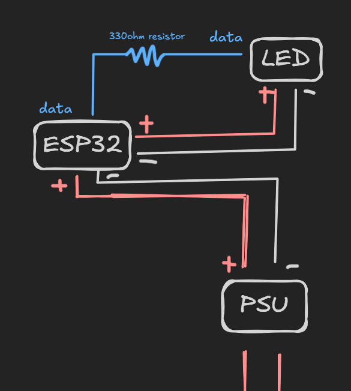

# Bleeding Bezel

**Bleeding Bezel is a monitor backlight system which responds to the actions taking place on the screen.**

## Working
 - On the device you have to run ```screen_capture.py```
 - This downscales the screen and process each pixel to map the colours of a row/column to a single LED on the LED strip
 - This colour info is then sent to the ESP32 which assigns the colours to the led strip.

## Schematic

<p align="center">
  
</p>


## Demo
Below is a simple demo where the 4 windows shows what the lights are going to look like.(The ones on the sies seem a bit weird because of their horizontal orientation)

<p align="center">
  
</p>

# [BOM](/BOM.csv)